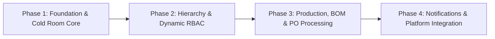

# Cyan International Management System (CIMS)
## Technical Specification & System Requirements

---

## 1. Architectural Rules, Tech Stack & Constraints

### 1.1 System Architecture & Overview
**CIMS** is a mobile-first food production management platform designed to:
- Control cold room inventory
- Automate Bill of Materials (BOM) processing
- Perform Purchase Order (PO) gap analysis with operator-guided stock batch allocation

The system follows a **cloud-first client-server architecture**:
- **Mobile Clients**: Role-tailored application client views built with Flutter.
- **Communication**: RESTful APIs over HTTPS with tenant-aware header routing (`X-Tenant-ID`).
- **Backend**: Centralized core backend server powered by NestJS.
- **Connectivity**: Cloud-first live connection. When network is unavailable, the client notifies the user with a `"No network found"` alert (offline local storage/sync is deferred).

### 1.2 Tech Stack
| Component | Technology | Details |
| :--- | :--- | :--- |
| **Backend Framework** | NestJS | TypeScript, modular REST API architecture |
| **Primary Database** | MongoDB Atlas | Cloud-hosted document database via Mongoose ODM |
| **Mobile Framework** | Flutter | Cross-platform (Android-focused API 26+, iOS ready) |
| **Data Strategy** | Cloud-First REST | Direct real-time API communication (no local SQLite queue) |
| **Email Service** | Nodemailer | Transactional OTP delivery via `.env` SMTP config (with dev fallback) |
| **Push Notifications**| Firebase Cloud Messaging (FCM) | Expiry and inventory shortage alerts |

### 1.3 System Constraints & Omissions
- **Explicit Omissions**: 
  - Audit logs and formal work orders are explicitly **out of scope**.
  - Local database caching and offline sync queues are **deferred**; operations run live against the cloud.
- **Scope Focus**:
  - Direct BOM gap analysis.
  - PO line-item produced quantity tracking with operator-confirmed batch deductions.
  - Inventory batch management (FEFO) across strict multi-tenant boundaries.

---

## 2. Core Data Entities & Schemas

The primary domain model enforces multi-tenancy via `tenant_id` and `TenantMemberships`. All entity identifiers use standard UUIDv4 strings.

### 2.1 Tenants
```typescript
Tenants {
  tenant_id:        UUID       // Unique identifier for tenant organization
  company_name:     String     // Legal / commercial company name
  admin_user_id:    UUID       // Reference to initial creator / tenant admin
  is_active:        Boolean    // Tenant operational status
  created_at:       Timestamp  // Creation timestamp
  updated_at:       Timestamp  // Last modification timestamp
}
```

### 2.2 Users
```typescript
Users {
  user_id:          UUID       // Unique user identifier
  full_name:        String     // User's full name
  email_address:    String     // Unique login email
  password_hash:    String     // Secure hashed password
  department_id:    UUID       // Primary department reference
  account_status:   Enum       // ACTIVE | INACTIVE | SUSPENDED
  created_at:       Timestamp  // Registration timestamp
  updated_at:       Timestamp  // Last update timestamp
}
```

### 2.3 Departments
```typescript
Departments {
  department_id:    UUID       // Unique department identifier
  department_code:  String     // e.g., "PROD", "QC", "INV"
  department_name:  String     // Descriptive name (e.g., "Cold Storage")
  description:      String     // Department responsibilities
  permission_ids:   List<UUID> // Set of assigned permission IDs
  created_at:       Timestamp  // Creation timestamp
}
```

### 2.4 TenantMemberships
```typescript
TenantMemberships {
  membership_id:   UUID        // Unique membership record identifier
  user_id:         UUID        // Reference to Users
  tenant_id:       UUID        // Reference to Tenants
  department_ids:  List<UUID>  // User's department allocations in this tenant
  is_active:       Boolean     // Active membership flag
  created_at:      Timestamp   // Creation timestamp
  updated_at:      Timestamp   // Last update timestamp
}
```

### 2.5 Permissions
```typescript
Permissions {
  permission_id:     UUID      // Unique permission identifier
  resource_name:     String    // e.g., "item", "storeroom", "bom", "po"
  action_type:       Enum      // CREATE | READ | UPDATE | DELETE
  description:       String    // Human-readable permission explanation
  is_system_default: Boolean   // Fixed system default flag (true)
}
```

### 2.6 StoreRooms
```typescript
StoreRooms {
  store_room_id:        UUID     // Unique cold room identifier
  tenant_id:            UUID     // Multi-tenant reference
  room_code:            String   // Room shorthand code (e.g., "CR-01")
  room_name:            String   // Room label (e.g., "Main Deep Freeze")
  temperature:          Decimal  // Operating temperature in °C
  total_capacity_units: Decimal  // Maximum total capacity
  is_active:            Boolean  // Operational status
}
```

### 2.7 Item
```typescript
Item {
  item_id:                     UUID     // Unique item identifier
  tenant_id:                   UUID     // Multi-tenant reference
  sku:                         String   // Unique product SKU per tenant
  item_name:                   String   // Product / Material title
  item_type:                   Enum     // RAW_MATERIAL | FINISHED_GOOD | PACKAGING
  measurement_unit:            Enum     // KILOGRAM | LITER | PIECE | CARTOON_BOX
  reorder_threshold_quantity:  Decimal  // Threshold triggering reorder alerts
  storage_location_details: {
    store_room_id:             UUID     // Assigned cold room
    location_code:             String   // Full location code
    rack_identifier:           String   // Rack identifier
    shelf_identifier:          String   // Shelf identifier
    bin_identifier:            String   // Bin identifier
    allowed_category:          Enum     // RAW_MATERIAL | FINISHED_GOOD | PACKAGING | ALL
    is_active:                 Boolean  // Location availability
  }
  created_at:                  Timestamp
}
```

### 2.8 StockBatch
```typescript
StockBatch {
  batch_id:             UUID       // Unique batch identifier
  tenant_id:            UUID       // Multi-tenant reference
  item_id:              UUID       // Associated Item reference
  batch_number:         String     // Batch tracking code
  storage_location_id:  UUID       // Exact location slot
  store_room_id:        UUID       // Cold room reference
  available_quantity:   Decimal    // Quantity remaining in stock
  manufacturing_date:   Timestamp  // Batch production date
  expiry_date:          Timestamp  // FEFO sorting & expiry tracking
  batch_status:         Enum       // AVAILABLE | RESERVED | EXPIRED | DISPATCHED
}
```

### 2.9 BOMFormula (Bill of Materials)
```typescript
BOMFormula {
  formula_id:             UUID     // Unique recipe identifier
  tenant_id:              UUID     // Multi-tenant reference
  finished_good_item_id:  UUID     // Associated finished good Item
  formula_version:        Integer  // Incremental formula version
  required_ingredients:   List<{
    raw_material_item_id: UUID     // Raw material reference
    ratio_quantity:       Decimal  // Amount needed per finished unit
    measurement_unit:     Enum     // Unit of measure
  }>
  is_active:              Boolean  // Formula active flag
  created_at:             Timestamp
}
```

### 2.10 PurchaseOrders
```typescript
PurchaseOrders {
  purchase_order_id:       UUID       // Unique PO identifier
  tenant_id:               UUID       // Multi-tenant reference
  po_number:               String     // Commercial PO identifier
  order_date:              Timestamp  // Order issuance timestamp
  expected_delivery_date:  Timestamp  // Due date
  po_status:               Enum       // DRAFT | ISSUED | PARTIALLY_FULFILLED | COMPLETED | CANCELLED
  line_items:              List<{
    item_id:               UUID       // Ordered item reference
    ordered_quantity:      Decimal    // Target order quantity
    produced_quantity:     Decimal    // Initialized to 0, incremented by authorized staff
    unit_price:            Decimal    // Agreed unit price
  }>
}
```

---

## 3. RBAC & Multi-Tenant Onboarding Flow

### 3.1 Authentication & Multi-Tenant Flow
1. **User Sign Up & Sign In**:
   - Authentication via Email Address and Password.
   - Verified through One-Time Password (OTP) dispatched using **Nodemailer** (reads SMTP credentials from `.env`; logs OTP in terminal during dev if SMTP is unconfigured).
2. **Tenant Creation**:
   - Upon sign-up, users can register a new Tenant by submitting company details.
   - The creator is automatically set as the Tenant Admin (`admin_user_id`).
3. **Multi-Tenant Selection**:
   - Users can belong to multiple tenants via `TenantMemberships`.
   - **Post-Login Tenant Selector**: If a user belongs to more than one tenant, the mobile app presents a **Tenant Selection Screen** so the user chooses which organization to operate under. If they belong to only one tenant, it is selected automatically.
   - **Request Context**: The selected tenant's ID is transmitted on every subsequent API request via the header:
     ```http
     X-Tenant-ID: <UUID>
     ```
   - The backend validates that the user is an active member of the specified `X-Tenant-ID` before fulfilling requests.
4. **User Invitation & Department Allocation**:
   - Tenant admins invite users by email.
   - Invited users **must be assigned to a specific department** during invitation.
   - **Department-Centric RBAC**: Permissions attach to departments, not individual users. All department members inherit its permission set.

### 3.2 Dynamic Departments & System Permissions
Tenant admins create departments dynamically and allocate permissions from system-provided defaults. Backend guards verify permissions using direct `permission_id` lookups with standardized dot-notation CRUD identifiers:

| Module | Create | Read | Update | Delete |
| :--- | :--- | :--- | :--- | :--- |
| **Items** | `permission.item.create` | `permission.item.read` | `permission.item.update` | `permission.item.delete` |
| **StoreRooms** | `permission.storeroom.create` | `permission.storeroom.read` | `permission.storeroom.update` | `permission.storeroom.delete` |
| **BOM Formulas** | `permission.bom.create` | `permission.bom.read` | `permission.bom.update` | `permission.bom.delete` |
| **Purchase Orders** | `permission.po.create` | `permission.po.read` | `permission.po.update` | `permission.po.delete` |
| **Departments** | `permission.department.create` | `permission.department.read` | `permission.department.update` | `permission.department.delete` |

---

## 4. Functional Modules & Acceptance Criteria

### 4.1 Item Management (`ItemsController`)
- **Endpoints**:
  - `GET    /items` — List all items in active tenant
  - `GET    /items/:id` — Get item details
  - `POST   /items` — Create new item
  - `PUT    /items/:id` — Update item
  - `DELETE /items/:id` — Soft-delete / deactivate item
- **Business Rules**:
  - Enforces unique SKU per tenant.
  - Automatically triggers reorder alerts when available stock across all batches drops below `reorder_threshold_quantity`.

### 4.2 StoreRoom Management (`StoreRoomsController`)
- **Endpoints**:
  - `GET    /store-rooms` — List store rooms
  - `GET    /store-rooms/:id` — Get room details
  - `POST   /store-rooms` — Create room
  - `PUT    /store-rooms/:id` — Update room
  - `DELETE /store-rooms/:id` — Deactivate room
- **Business Rules**:
  - Enforces capacity limits to prevent batch over-allocation.
  - Rejects stock allocation to inactive rooms.

### 4.3 BOM Formula & Production Management (`BomFormulasController`)
- **Endpoints**:
  - `GET    /bom-formulas` — List formulas
  - `GET    /bom-formulas/:id` — Get formula details
  - `POST   /bom-formulas` — Create formula
  - `PUT    /bom-formulas/:id` — Update formula
  - `DELETE /bom-formulas/:id` — Deactivate formula
  - `POST   /bom-formulas/simulate-allocation` — Suggest FEFO batch picks for a target output quantity
- **Business Rules**:
  - Strict recipe version tracking.
  - Blocks production if raw material deficits exist.
  - **Semi-Automated FEFO Allocation (Option B)**: The backend suggests raw material batches according to First-Expired, First-Out (FEFO). The mobile interface allows the operator to review, edit quantities, and explicitly confirm the exact batches consumed before inventory is deducted.

### 4.4 Purchase Order Management (`PurchaseOrdersController`)
- **Endpoints**:
  - `GET    /purchase-orders` — List POs
  - `GET    /purchase-orders/:id` — Get PO details
  - `POST   /purchase-orders` — Create PO
  - `PUT    /purchase-orders/:id` — Update PO
  - `DELETE /purchase-orders/:id` — Cancel PO
  - `POST   /purchase-orders/:id/record-production` — Increment line item produced quantity & deduct confirmed ingredient batches
- **Business Rules**:
  - Tracks line-item `ordered_quantity` vs `produced_quantity`.
  - Calculates net ingredient gaps and generates purchase requisition summaries.

### 4.5 Department & User Management (`DepartmentsController` & `UsersController`)
- **Endpoints**:
  - `GET / POST / PUT / DELETE /departments`
  - `GET / POST / PUT / DELETE /users`
- **Business Rules**:
  - Enforces dot-notation permission guards on every endpoint.
  - Prevents department deletion while active user memberships exist.

### 4.6 Tenant & Onboarding Management (`TenantsController` & `TenantMembershipsController`)
- **Endpoints**:
  - `GET / POST / PUT / DELETE /tenants`
  - `GET / POST / PUT / DELETE /tenant-memberships`
- **Business Rules**:
  - `X-Tenant-ID` header validation on all protected requests.
  - Strict tenant boundary isolation at query execution level.

---

## 5. Mobile Application Specifications

### 5.1 Platform Target & Connectivity Architecture
- **Target Platform**: Flutter cross-platform targeting Android (API Level 26+) with iOS support.
- **Connectivity Architecture**:
  - **Cloud-First Live Connection**: Directly consumes backend REST APIs.
  - **No-Network Guard**: If internet or server connectivity is lost, the application immediately surfaces a clear visual barrier:
    > *"No network found. Please check your internet connection."*
  - Offline local SQLite storage and synchronization queues are **deferred**.

### 5.2 Technical Acceptance Criteria for Mobile
1. **Ergonomics**: Touch targets must be minimum **48 × 48 dp** for shop floor / glove operation.
2. **Tenant Switching**: Users belonging to multiple tenants can switch their active tenant at any time from the app drawer or profile menu.
3. **FEFO Confirmation Flow**: Operators can view suggested ingredient batches, modify consumed quantities or switch batches if physical stock differs, and confirm before submitting.
4. **Notification Latency**: Push notifications deliver expiry and shortage alerts within **< 2 seconds** of server trigger.

---

## 6. Implementation Roadmap



### Phase 1: Foundation & Cold Room Inventory Core
- **Backend (NestJS + MongoDB Atlas)**:
  - Project scaffolding with TypeScript & Mongoose.
  - `.env` configuration for MongoDB Atlas URI, JWT secret, and Nodemailer SMTP.
  - Auth module with Nodemailer OTP verification (with console logging fallback).
  - Multi-tenant guard validating `X-Tenant-ID` header against `TenantMemberships`.
  - `StoreRooms`, `Item`, and `StockBatch` management APIs.
  - Initial FEFO stock suggestion engine.
- **Mobile (Flutter)**:
  - Project scaffolding with clean architecture.
  - Authentication flow (Sign up, Sign in, OTP verification).
  - Tenant selector screen (for multi-tenant users) & persistent tenant header interceptor.
  - Network connectivity banner/dialog (*"No network found"*).
  - Cold room storage layout viewer & Item/Batch catalog views.

### Phase 2: Organization Hierarchy & Dynamic RBAC
- **Backend (NestJS)**:
  - `Departments` management module.
  - `TenantMemberships` mapping logic.
  - System-default Permission seeders.
  - Request-level API authorization guards enforcing dot-notation permissions.
- **Mobile (Flutter)**:
  - User invitation workflow.
  - Department assignment UI.
  - Dynamic UI component rendering based on authenticated user's department permissions.

### Phase 3: Production & Purchase Order Processing
- **Backend (NestJS)**:
  - `BOMFormula` versioning engine.
  - `PurchaseOrder` lifecycle workflow.
  - Automatic BOM shortfall gap analysis.
  - Semi-automated FEFO batch deduction API (Option B).
- **Mobile (Flutter)**:
  - Production Supervisor dashboard.
  - Floor execution logging screen with editable batch deduction confirmation.
  - BOM deficit validation alerts.
  - Incremental PO produced quantity progress updates.

### Phase 4: Push Notifications & Final Platform Integration
- **Backend (NestJS)**:
  - Firebase Cloud Messaging (FCM) push notification engine for shortage and expiry alerts.
  - End-to-end integration test suites across multi-tenant boundaries.
- **Mobile (Flutter)**:
  - Push notification listeners for expiry and inventory alerts.
  - Production packaging and Android build optimization.
  - System-wide regression verification.
